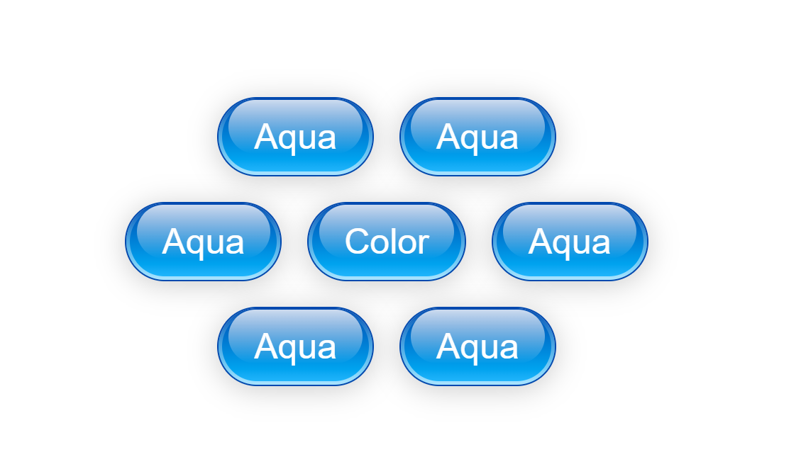

# aqua-buttons
Html buttons in the style of MacOS Aqua Buttons, using pure css. 

## Usage
Copy the styles for the button element and css variables in  `index.html`.

## Changing the color of the button. 
Change the `--shade2` css variable to be the lighter color (bottom side of button). It will automatically derive the darker shade of the color you gave. 

For black and white colors it's better to input both colors yourself by modifying `--shade1` (top) and `shade2` (bottom).

> The css function that derives the darker shade tries to do so in a natural way using hue, saturation and lightness. So pure white (turns to a cream-ish dark shade) and pure black (has no darker shade) wont look like you imagined.